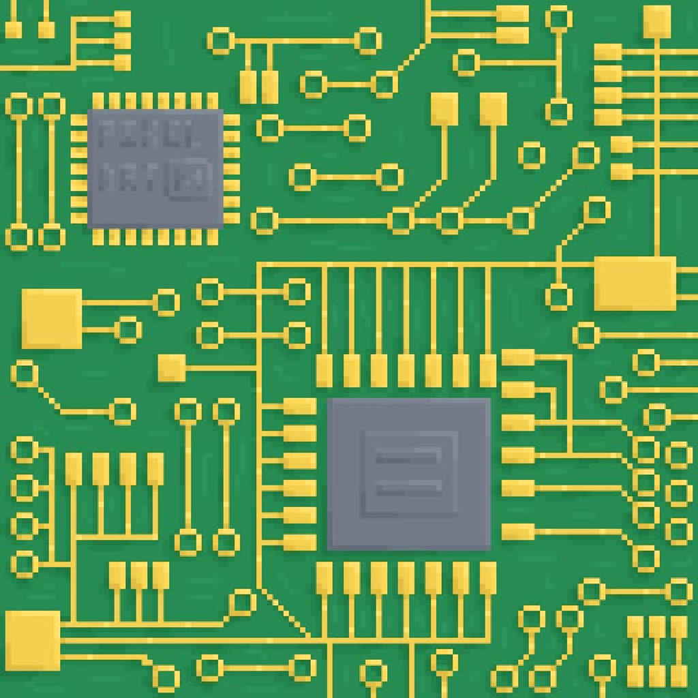

# Commutator

Run coding agents on your machines and drive them from the desktop or a phone.
The engine on each machine starts the agent CLIs you already have installed,
keeps their sessions running in the background and records every turn. A
small server signs your devices in with Google and relays traffic between
them, so the iPhone, the Android phone or another computer can open a chat on
any machine of the account.

The engine, mobile core and desktop interface are a fork of
[Zeron](https://github.com/zeronsh/zeron) (MIT), with its Cloud, billing,
WorkOS and voice parts removed.

## Agents

Claude Code, Codex, Cursor, OpenCode, Pi, Grok, Hermes, Devin, Muse Code, fx
and Antigravity. Commutator finds them on `PATH`; Settings → Providers →
**Install** runs the vendor's own installer on the selected machine. Commands
and protocol notes are in [`crates/harness/README.md`](crates/harness/README.md).

## Layout

| Path | What it is |
| --- | --- |
| `apps/commutator` | The `commutator` binary: desktop window, headless engine, CLI |
| `apps/commutator-server` | Google sign-in, the account's devices, relay and WebRTC signaling |
| `apps/ios`, `apps/android` | Phone apps on the shared Rust core in `crates/mobile` |
| `crates/engine` | Sessions, terminals, previews, per-turn git checkpoints |
| `crates/harness` | One driver per agent CLI (ACP, Claude, Codex, Muse, …) |
| `crates/client` | Talks to an engine over local IPC or through the server relay |
| `crates/ui` | The GPUI desktop interface |

## Build

Rust stable (edition 2024).

```sh
cargo build --release -p commutator --bins
./target/release/commutator            # open the window
```

On macOS, `make app` packs and signs `target/Commutator.app` (`SIGN_ID` names
the certificate), `make run` opens it and `make notarize` writes a notarized
`target/Commutator-<version>.dmg`. `make release` publishes that version as a
GitHub release the installed apps update from.

The phone apps have their own instructions:
[iOS](apps/ios/README.md), [Android](apps/android/README.md).

## Use

Without an account the engine serves only this machine. To reach it from your
other devices, sign it in and restart the engine:

```sh
commutator login https://commutator.freethinkel.dev
commutator login https://… --paste   # over SSH, or with no browser here
commutator status
```

Later `commutator login` calls reuse the last server, or `COMMUTATOR_SERVER_URL`.
The phone apps offer `commutator.freethinkel.dev` on their sign-in screen.

Other commands:

- `commutator headless` runs the engine without a window.
- `commutator daemon install` keeps it running as a launchd or `systemd --user` service.
- `commutator mcp` serves an MCP server on stdio, so agents can create and message chats.
- `commutator update` installs the newest GitHub release after checking its sha256.

The desktop app checks GitHub releases hourly and shows "Update available" in
the sidebar. Clicking it downloads the release, then "Update ready — restart to
apply"; a downloaded update you never restart for installs on quit.
`COMMUTATOR_AUTO_UPDATE=1` downloads in the background without the click, and
is also what lets a headless engine update itself.

## Own server

The default server only lets in the accounts it lists. To run your own,
follow [`apps/commutator-server/README.md`](apps/commutator-server/README.md)
and pass its URL to `commutator login`.

## License

MIT, see [LICENSE](LICENSE) and [THIRD_PARTY_NOTICES.md](THIRD_PARTY_NOTICES.md).
